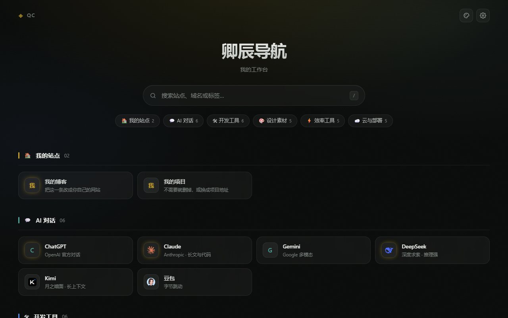
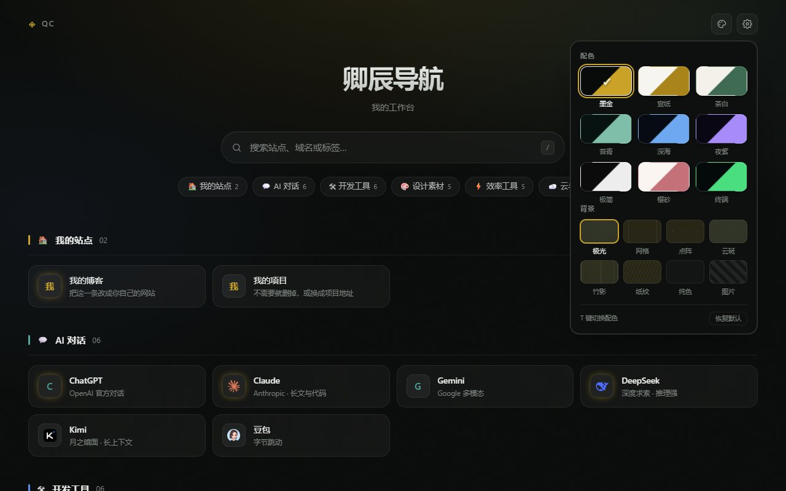
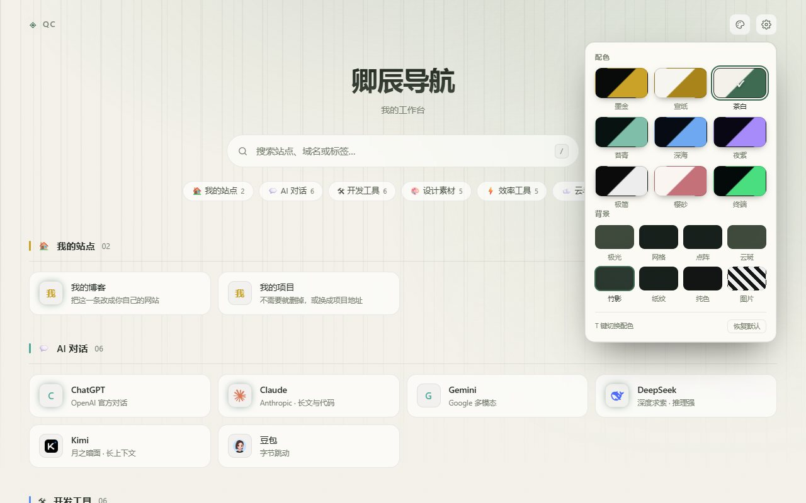
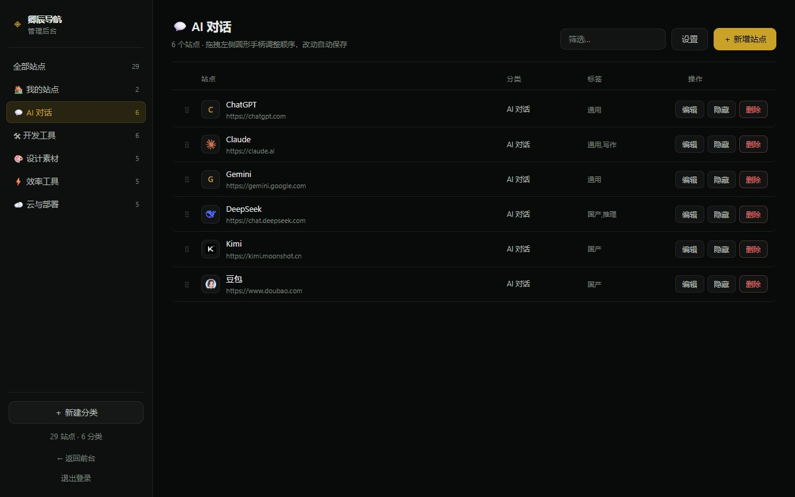

# 卿辰导航

一个**自带后台**的个人站点导航页。PHP + SQLite，零第三方依赖，解压上传就能用。

用来把散落在浏览器收藏夹里的站点收拢成一页：按分类排好、自动抓图标、支持搜索，并且随时能在后台增删改。



---

## 特性

- **自带管理后台** — 站点与分类的增删改、拖动排序、显示/隐藏，不需要碰数据库
- **9 套配色 × 8 种背景** — 访客可以自己换，选择记在本地；后台设默认值
- **图标自动抓取** — 服务端解析目标站点的 `<link rel="icon">`，抓不到再退 `/favicon.ico`，本地缓存 30 天
- **零依赖** — 不需要 Composer、不需要 MySQL，只要 PHP 自带的 PDO SQLite
- **可装子目录** — 放在 `example.com/` 或 `example.com/nav/` 都能跑，不用改配置
- **可选访问码** — 不想公开就在后台开「访问码保护」，30 天内免重复输入
- **导入导出** — 后台一键导出 JSON，换服务器直接导入
- **安全基线** — 密码 bcrypt、CSRF Token、登录失败锁定、favicon 代理带 SSRF 防护

---

## 界面预览

**主题面板**：9 套配色 × 8 种背景，点一下即时生效，选择记在本地



**换一套就是另一种气质**（茶白 + 竹影）



**后台**：增删改站点、拖拽排序、显示隐藏、导入导出都在这一页



---

## 环境要求

| 项目 | 要求 |
|---|---|
| PHP | 8.0 及以上 |
| 扩展 | `pdo_sqlite`、`curl`、`mbstring`（一般默认都有） |
| Web 服务器 | Nginx / Apache / Caddy 均可 |
| 数据库 | 不需要，用文件型 SQLite |

检查扩展是否齐全：

```bash
php -m | grep -E 'pdo_sqlite|curl|mbstring'
```

---

## 安装

### 1. 上传文件

把整个目录传到网站目录，例如 `/www/wwwroot/example.com/nav/`。

### 2. 给 data 目录写权限

```bash
# 用户/组按你的环境改，下面以 www 为例
chown -R www:www /www/wwwroot/example.com/nav
chmod -R 755 /www/wwwroot/example.com/nav
chmod -R 775 /www/wwwroot/example.com/nav/data
```

### 3. 打开安装向导

浏览器访问 `https://你的域名/nav/install.php`（装在根目录就是 `/install.php`）。

填站点名称、管理员用户名和密码，提交即可。安装完**请删除 `install.php`**。

---

## 目录结构

```
.
├── index.php            前台页面（站点数据内嵌进 HTML，首屏无需额外请求）
├── admin/index.php      管理后台
├── api.php              所有接口（登录、增删改、设置、导入导出）
├── lib.php              公共库（数据库、会话、认证、工具函数）
├── seed.php             首次安装导入的示例站点
├── favicon.php          图标代理与缓存（带 SSRF 防护）
├── install.php          安装向导，装完请删除
├── favicon.svg          站点图标
├── assets/
│   ├── theme.css        主题变量：9 套配色 × 8 种背景
│   ├── style.css        前台样式
│   ├── app.js           前台逻辑
│   ├── admin.css        后台样式
│   └── admin.js         后台逻辑
└── data/                ← 运行时数据，务必禁止外部访问
    ├── nav.db           SQLite 数据库
    └── fav/             图标缓存
```

---

## 使用

### 后台

访问 `/admin/`，用安装时设的账号登录。

- **新增站点** — 右上角「＋ 新增站点」，网址不用写 `http://`，会自动补全
- **排序** — 进入某个分类，拖左侧 `⠿` 手柄，松手自动保存
- **隐藏** — 不想删但要暂时下线的，点「隐藏」
- **分类** — 左侧「＋ 新建分类」；双击分类名可直接编辑
- **设置** — 站点标题、默认主题、访问码、改密码、导入导出

### 前台

| 操作 | 说明 |
|---|---|
| `/` | 聚焦搜索框 |
| `T` | 循环切换配色 |
| `Esc` | 关闭主题面板 / 清空搜索 |
| 右上角调色板 | 换配色和背景，选择存 localStorage |

### 主题

9 套配色：墨金、宣纸、茶白、苔青、深海、夜紫、极简、樱砂、终端
8 种背景：极光、网格、点阵、云斑、竹影、纸纹、纯色、图片

「图片」背景需要在后台填一张图的 URL 并调浓度。

---

## 部署配置

### Nginx

见 [`nginx.example.conf`](nginx.example.conf)。关键是不让 `data/` 被下载：

```nginx
location ^~ /data/ { return 404; }
location ~ ^/(lib|seed)\.php$ { return 404; }
```

### Apache

仓库里的 `data/.htaccess` 已写好 `Require all denied`。如果整站用了 `AllowOverride None`，需要改在 vhost 里：

```apache
<Directory "/path/to/nav/data">
    Require all denied
</Directory>
```

### Docker（最省事，不用装 PHP）

镜像自带 Apache + PHP 8.2，基础镜像已内置 `pdo_sqlite` / `curl` / `mbstring`，不用额外装扩展。

**方式一：docker compose**

把下面这段存成 `docker-compose.yml`（或者直接用仓库里那份，改一下密码）：

```yaml
services:
  qcnav:
    image: ghcr.io/foxnangang/qingchen-nav:1.1.1
    container_name: qcnav
    ports:
      - "18090:80"
    environment:
      TZ: Asia/Shanghai
      QC_ADMIN_PASS: "foxnan888"   # ⚠️ 至少 8 位，装好后请改
    volumes:
      - ./data:/var/www/html/data
    restart: unless-stopped
```

然后：

```bash
docker compose up -d
```

> 🔑 **默认账号是 `admin` / `foxnan888`**。这个默认值只是让你贴完就能跑，**装好请立刻到后台「设置 → 修改密码」换掉**。

**关于端口写法**

`"18090:80"` 是 `宿主机端口:容器端口`：

| 写法 | 结果 |
|---|---|
| `"18090:80"` | ✅ 默认值，访问 `http://IP:18090` |
| `"8090:80"` | ✅ 换别的端口也可以，访问 `http://IP:8090` |
| `"18090:18090"` | ❌ 打不开 —— 容器里 Apache 只监听 80，没人听 18090 |

一句话：**冒号左边随便改，右边永远留 `80`**。

> 默认端口给到 **18090**，是因为玩 NAS 的人 8090 大多已经被别的服务占了。

**方式二：docker run**

```bash
docker run -d --name qcnav \
  -p 18090:80 \
  -e QC_ADMIN_PASS='换成你自己的密码' \
  -e TZ=Asia/Shanghai \
  -v qcnav-data:/var/www/html/data \
  --restart unless-stopped \
  ghcr.io/foxnangang/qingchen-nav:latest
```

起来后打开 `http://服务器IP:18090`。

**环境变量**

| 变量 | 必填 | 说明 |
|---|---|---|
| `QC_ADMIN_PASS` | 否 | **设了就在启动时自动装好**；留空则打开网页用 `install.php` 手动装 |
| `QC_ADMIN_USER` | 否 | 管理员账号，默认 `admin` |
| `QC_TITLE` | 否 | 站点标题，默认「卿辰导航」 |
| `QC_SUBTITLE` | 否 | 副标题 |
| `QC_OWNER` | 否 | 左上角署名 |
| `TZ` | 否 | 时区，默认 `Asia/Shanghai` |

自动安装完成后，容器里的 `install.php` 会被自动改名停用，不用手动删。

**关于 `QC_ADMIN_PASS`（管理员密码）**

四条规则，看完能避开 90% 的坑：

| # | 规则 |
|---|---|
| 1 | **至少 8 位**，建议字母 + 数字混排。默认的 `foxnan888` 是 9 位，能跑，但请改掉 |
| 2 | 只在**第一次启动、还没有数据库**时生效，用它创建 `admin` 账号 |
| 3 | **已经装好之后再改这里没用** —— 改密码请登录后台「设置 → 修改密码」 |
| 4 | 填了**不足 8 位**的密码，自动安装会跳过，你会看到安装页而不是导航页（页面顶部会写原因） |

整串建议加双引号，免得密码里的 `$`、`#`、`:` 被 YAML 吃掉。没想好密码可以用 `openssl rand -base64 12` 生成一串。

> ⚠️ **没有找回功能**。忘了只能手动改库，命令见下面「忘记密码怎么办」。

**数据持久化**

上面的 compose 把 `./data`（compose 文件同级的 data 目录）挂进容器。容器启动时会自动把属主修成 `www-data`，所以本地磁盘直接能用，数据也能在文件管理器里看到。

> ⚠️ **如果 `./data` 指向的是 SMB / NFS 网络挂载**，容器改不了属主，SQLite 会写不进去（表现为页面能开、但保存站点报错）。这种情况换成 named volume：
>
> ```yaml
> services:
>   qcnav:
>     # ...
>     volumes:
>       - qcnav-data:/var/www/html/data
>
> volumes:
>   qcnav-data:
> ```

备份 / 恢复：

```bash
# 备份
docker run --rm -v qcnav-data:/data -v "$PWD":/backup alpine \
  tar czf /backup/qcnav-backup.tar.gz -C /data .

# 恢复
docker run --rm -v qcnav-data:/data -v "$PWD":/backup alpine \
  sh -c 'rm -rf /data/* && tar xzf /backup/qcnav-backup.tar.gz -C /data'
```

**升级**

```bash
docker pull ghcr.io/foxnangang/qingchen-nav:latest
docker rm -f qcnav
# 再用上面那条 run 命令重新起，数据在 volume 里不会丢
```

**自己构建**

```bash
docker build -t qcnav .
docker run -d -p 18090:80 -e QC_ADMIN_PASS='你的密码' -v qcnav-data:/var/www/html/data qcnav
```

**国内拉取慢怎么办**

`ghcr.io` 国内直连通常只有 1–2 MB/s，第一次拉大概要十几分钟。有两个办法：

1. **等它拉完** —— 实际下载的是压缩层，约 200 MB（显示的 500 MB 是解压后体积）。Docker 有层缓存，以后升级只下变化的层，不会每次全量。
2. **换镜像站**（快很多）：

```yaml
services:
  qcnav:
    image: ghcr.nju.edu.cn/foxnangang/qingchen-nav:1.1.1   # 南大镜像站
```

拉下来后想换回官方名字：

```bash
docker tag ghcr.nju.edu.cn/foxnangang/qingchen-nav:1.1.1 \
           ghcr.io/foxnangang/qingchen-nav:1.1.1
```

> 镜像站是第三方反代，内容由 Docker 校验 digest，一般不会出问题；在意的话可以拉完用
> `docker images --digests | grep qingchen-nav` 跟官方 digest 对一下。

镜像约 **500 MB**（`php:8.2-apache` 基础镜像占绝大部分）。

放在 Nginx/Caddy 反代后面也没问题：程序认 `X-Forwarded-Proto`，会自动给 session cookie 打上 `Secure`。

---

## 数据与备份

所有数据都在 `data/nav.db` 一个文件里。**备份就是复制它**（连同 `data/fav/` 可选）：

```bash
tar czf nav-backup-$(date +%F).tar.gz data/
```

换服务器时把 `data/` 一起带过去即可，不用重装。

### 忘记密码怎么办

没有找回功能（本来就该如此）。用命令行重置：

```bash
cd /path/to/nav
php -r 'require "lib.php"; nav_set("admin_hash", password_hash("你的新密码", PASSWORD_DEFAULT));'
```

或者接受丢数据：删掉 `data/nav.db`，重新访问 `install.php`。

---

## 常见问题

**装完打开是 500**
看 PHP 错误日志。多数是 `data/` 没写权限，或 PHP 版本低于 8.0。

**图标都是首字方块**
- 海外站点（ChatGPT、Figma 等）服务器在国内抓不到，属正常，前端会退回首字
- 自建站如果没有 favicon 也抓不到，可以给站点补一个，或在后台填「自定义图标 URL」
- 想让某站重新抓一次：删掉 `data/fav/<域名>.meta` 再刷新

**装在子目录后样式全丢**
说明用的是旧版本（早期版本把资源路径写死成 `/assets/`）。本版本已支持，无需额外配置。

**能不能换数据库**
不行，整个设计就是围绕 SQLite 单文件展开的 —— 好处是零配置、备份简单。

---

## 安全建议

- 装完立刻删除 `install.php`
- 生产环境务必上 HTTPS（登录 Cookie 的 `Secure` 标记依赖它）
- 后台入口 `/admin/` 可以再套一层 Basic Auth 或 IP 白名单
- 定期备份 `data/nav.db`

---

## License

[MIT](LICENSE)
